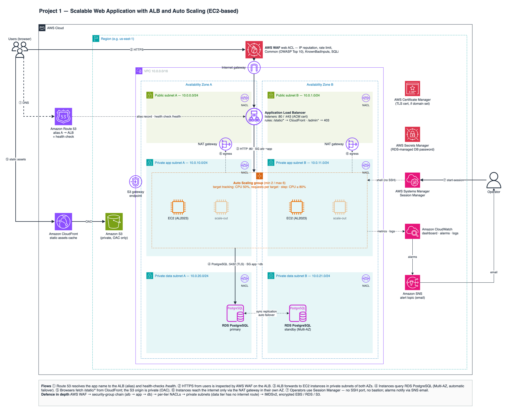

# Project 1 — Scalable Web Application with ALB and Auto Scaling (EC2-based)

A production-style web application on AWS, defined in a single CloudFormation template. EC2
instances run in **private subnets across two Availability Zones** behind an **Application Load
Balancer protected by AWS WAF**. An **Auto Scaling group** scales on target-tracking and
step-scaling policies. **RDS PostgreSQL Multi-AZ** is the database. **CloudFront** serves static
assets from a private S3 bucket. **Route 53** provides the alias record and health check,
**Session Manager** replaces SSH and bastions, and **CloudWatch + SNS** provide the dashboard,
alarms and email notifications.



Editable source: [`diagrams/architecture.drawio`](diagrams/architecture.drawio). Open it in
[diagrams.net](https://app.diagrams.net) (File → Open from → Device) or in draw.io desktop.

## Repository layout

| Path | What it is |
| --- | --- |
| `cloudformation/webapp.yaml` | The whole stack (≈100 resources): VPC, NACLs, SGs, ALB, WAF, ASG, RDS, CloudFront, Route 53, CloudWatch, SNS |
| `static/` | Static assets uploaded to S3 and served through CloudFront |
| `diagrams/` | Architecture diagram (`.drawio` source + exported `.png`) |
| `scripts/deploy.sh` | Create/update the stack, upload `static/`, invalidate CloudFront |
| `scripts/stress.sh` | Burn CPU on all instances via SSM Run Command to trigger scaling |
| `scripts/teardown.sh` | Empty the bucket and delete the stack |
| `scripts/check.sh` | Local checks, no AWS calls: cfn-lint, architecture tests, diagram tests, shellcheck |
| `tests/` | pytest suites behind `check.sh` |

## Architecture

| Layer | Service | How it is built (logical IDs in the template) |
| --- | --- | --- |
| Network | **VPC** `10.0.0.0/16` | 6 × /24 subnets: public `10.0.0-1`, private app `10.0.10-11`, private data `10.0.20-21`, one of each per AZ (`PublicSubnetA/B`, `AppSubnetA/B`, `DbSubnetA/B`) |
| | Internet + NAT gateways | `InternetGateway` on the public route table. `NatGatewayA/B`, one per AZ, each app route table egressing through its own AZ (`NatGatewayMode=Single` for dev) |
| | Route tables | Public → IGW. App A/B → NAT A/B. Data → **no default route at all** |
| | NACLs | `PublicNacl` (80/443/ephemeral in), `AppNacl` (80 only from public subnets, 443 from VPC, ephemeral replies), `DbNacl` (5432 only from app subnets) |
| | Security groups | Chain `AlbSecurityGroup → AppSecurityGroup → DatabaseSecurityGroup`; no SSH anywhere |
| | VPC endpoints | Free S3 gateway endpoint; optional SSM interface endpoints (`EnableSsmVpcEndpoints=true`) |
| Edge | **ALB** | Internet-facing in public subnets. HTTP:80 (redirects to HTTPS when a domain is set) and HTTPS:443 (TLS 1.3 policy, ACM cert). Listener rules: `/static/*` → 301 to CloudFront, `/admin*` → fixed 403. Target group health check `GET /health` |
| | **AWS WAF** | Regional web ACL on the ALB: Amazon IP reputation list, per-IP rate limit (2000 / 5 min), Core rule set (OWASP Top 10), Known bad inputs, SQL injection. Logs to `aws-waf-logs-<project>` |
| | **CloudFront** | S3 origin with Origin Access Control, managed CachingOptimized and SecurityHeaders policies, HTTPS only |
| | **Route 53** | `AppDnsRecord`: alias A record → ALB (when `DomainName` is set). `HealthCheck`: probes `/health` from Route 53 locations (on the ALB DNS name if no domain) |
| Compute | **EC2 + Auto Scaling** | Launch template: Amazon Linux 2023, IMDSv2 required, encrypted gp3, no key pair, detailed monitoring. ASG min 2 / max 6 across both private app subnets with ELB health checks |
| | Scaling policies | Target tracking on CPU (50%) and ALB requests per target (1000/min). Step scaling: +1 instance at CPU ≥ 80%, +2 at ≥ 90% |
| Data | **RDS PostgreSQL Multi-AZ** | Synchronous standby in the second AZ with automatic failover. Encrypted, private, 7-day backups, storage autoscaling to 200 GiB. Master password generated and rotated by RDS in Secrets Manager. Final snapshot on delete |
| Ops | **Systems Manager** | `AmazonSSMManagedInstanceCore` on the instance role, so Session Manager works with no inbound ports and no bastion host |
| | **CloudWatch + SNS** | `Dashboard` (ALB, targets, ASG, CPU/memory/disk, RDS, WAF, CloudFront, health check). Alarms (unhealthy hosts, 5xx, p95 latency, CPU, RDS CPU/storage, health check) → `AlertsTopic` email. CloudWatch agent ships app logs to `/<project>/app` |

### Request flow

1. The browser resolves `app.example.com` in Route 53, which returns an alias to the ALB.
2. HTTPS reaches the ALB, and AWS WAF inspects every request first.
3. The ALB forwards the request to a healthy instance in either AZ on port 80. Only the ALB security group may connect.
4. The app reads the DB password from Secrets Manager (via its IAM role) and queries RDS over TLS on port 5432. Only the app security group may connect.
5. The page loads `/static/*` from CloudFront. The S3 bucket is private and readable only by this distribution.
6. Instances reach the internet (package installs, AWS APIs) only through the NAT gateway in their own AZ.
7. Operators connect with Session Manager. CloudWatch alarms email them through SNS.

### Defence in depth

AWS WAF → security-group chain → per-tier NACLs (stateless, replies allowed explicitly) → private
subnets (the data tier has no internet route) → IMDSv2 only → encryption at rest for EBS, RDS
and S3, plus an S3 deny-non-TLS policy → no SSH and no long-lived credentials (the DB password
lives in Secrets Manager).

## Deploy

**Prerequisites**

- An AWS account and AWS CLI v2, with credentials allowed to create IAM roles, VPC, EC2, ELB,
  WAF, RDS, CloudFront, S3, Route 53, SNS and CloudWatch resources.
- Region **us-east-1** is recommended. Route 53 health-check metrics are published only there
  ([docs](https://docs.aws.amazon.com/Route53/latest/DeveloperGuide/monitoring-health-checks.html)),
  so the template creates the health-check alarm only in us-east-1. Every other part works in
  any Region.
- Optional: a Route 53 public hosted zone, for HTTPS on your own domain.
- For CLI sessions: the
  [Session Manager plugin](https://docs.aws.amazon.com/systems-manager/latest/userguide/session-manager-working-with-install-plugin.html).

```bash
# HTTP on the ALB's DNS name (no domain needed)
scripts/deploy.sh you@example.com

# HTTPS on your own domain: ACM certificate + Route 53 alias, HTTP redirects to HTTPS
scripts/deploy.sh you@example.com DomainName=app.example.com HostedZoneId=Z0123456789ABCDEFGHIJ

# A second, cheaper copy. ProjectName must differ: it prefixes fixed resource names (ALB, ASG, DB, WAF)
STACK_NAME=webapp-dev scripts/deploy.sh you@example.com ProjectName=webapp-dev NatGatewayMode=Single
```

The first create takes roughly 25–35 minutes, mostly RDS Multi-AZ. Confirm the SNS email
subscription, or you will not receive alarms. The template is kept under the 51,200-byte
inline limit
([quotas](https://docs.aws.amazon.com/AWSCloudFormation/latest/UserGuide/cloudformation-limits.html)),
so no S3 bucket is needed to deploy it. `tests/test_template.py` enforces that. If you grow the
template past the limit, add `--s3-bucket <bucket>` to the `aws cloudformation deploy` call.

Key parameters:

| Parameter | Default | Notes |
| --- | --- | --- |
| `AlertEmail` | — | Required |
| `NatGatewayMode` | `PerAZ` | `Single` halves NAT cost but loses egress if that AZ fails |
| `InstanceType` | `t3.micro` | x86_64 types only (the AMI parameter is x86_64) |
| `AsgMinSize` / `AsgMaxSize` | 2 / 6 | Min ≥ 2 keeps an instance in each AZ |
| `CpuTargetPercent` / `RequestsPerTarget` | 50 / 1000 | Target-tracking values |
| `DBEngineVersion` / `DBInstanceClass` | `17` / `db.t3.micro` | RDS picks the preferred minor version |
| `DBDeletionProtection` | `false` | Set `true` for real production; it blocks stack deletion |
| `DomainName` / `HostedZoneId` | empty | Both or neither (enforced by a template rule) |
| `EnableSsmVpcEndpoints` | `false` | Interface endpoints keep Session Manager traffic inside the VPC |

## Try it: one exercise per learning outcome

Set `URL` to the `AppUrl` stack output first.

| Learning outcome | Exercise | Expected result |
| --- | --- | --- |
| HA across AZs, ALB routing | `for i in $(seq 10); do curl -s $URL/ \| grep -o 'Zone <code>[^<]*' \| cut -d'>' -f2; done` | Responses come from both AZs |
| ALB listener rules | `curl -sI $URL/static/style.css` and `curl -s -o /dev/null -w '%{http_code}\n' $URL/admin` | `301` to the CloudFront domain, and `403` from the ALB itself |
| CloudFront caching | `curl -sI "<StaticAssetsUrl>style.css"` twice | `x-cache: Miss from cloudfront`, then `Hit from cloudfront` |
| WAF (OWASP) | `curl -s -o /dev/null -w '%{http_code}\n' "$URL/?q=%3Cscript%3Ealert(1)%3C/script%3E"` and `"$URL/?id=1%27%20OR%20%271%27%3D%271"` | `403` (XSS / SQLi blocked). See samples under WAF → Web ACLs → Sampled requests |
| Multi-AZ failover | `curl -s $URL/db`, then `aws rds reboot-db-instance --db-instance-identifier webapp-db --force-failover` (`<ProjectName>-db`), then `curl -s $URL/db` again after 1–2 min | `server_ip` changes: the standby in the other AZ became primary |
| Auto Scaling (step + target tracking) | `scripts/stress.sh 10` | `CpuHighAlarm` fires and the ASG adds 1–2 instances, then scales back in after the load stops |
| Self-healing | Terminate one instance in the EC2 console | The ASG launches a replacement. `UnhealthyHostsAlarm` emails you if the target fails health checks |
| Session Manager (no bastion) | EC2 console → instance → Connect → Session Manager, or `aws ssm start-session --target <instance-id>` | A shell with no SSH port open. `sudo tail -f /var/log/webapp/app.log` |
| Monitoring | Open `DashboardUrl` | Live ALB, ASG, RDS, WAF, CloudFront and health-check widgets |

## Cost

Use the [AWS Pricing Calculator](https://calculator.aws/) for your Region. The main ongoing
costs, roughly in order:

- NAT gateways: hourly per gateway plus per-GB processed. Two by default.
- RDS Multi-AZ: you pay for both the primary and the standby instance, plus storage.
- ALB: hourly plus LCUs.
- AWS WAF: per web ACL, per rule, and per million requests.
- SSM interface endpoints, if enabled: hourly per endpoint per AZ.
- Smaller items: CloudWatch dashboard, alarms and logs; Route 53 health check and hosted zone; CloudFront.

To keep costs down: use `NatGatewayMode=Single` for experiments, and run `scripts/teardown.sh`
when you are done. Teardown leaves the final RDS snapshot; delete it if you don't need it.

## Local checks

```bash
scripts/check.sh
```

This runs with no AWS calls.

- **cfn-lint**: the template is valid CloudFormation (resource schemas, references, conditions, `Fn::Sub` variables).
- **tests/test_template.py**: the template implements the architecture described
  above. Examples: compute only in private subnets, a NAT gateway per AZ, no internet route
  from the data tier, NACLs on every subnet, the SG chain, no SSH, IMDSv2, Multi-AZ +
  encrypted RDS, a private S3 bucket readable only by the distribution, WAF rule groups,
  target-tracking and step policies, every alarm notifying SNS, valid dashboard JSON, user
  data under 16 KB, and the template under 51,200 bytes. It also extracts the app from the
  user data and runs it (`/health`, `/`, `/db` returning 503 without a database, 404).
- **tests/test_diagram.py**: the `.drawio` file is well formed and shows every component.
- **bash -n / shellcheck** on the helper scripts.

These checks cannot prove runtime behaviour in a real account: package installs at boot, WAF
verdicts, failover timing. That is what the exercises above are for.

## Design notes

- **Route 53 → ALB directly; CloudFront only for static assets.** This follows the brief
  (alias record to the ALB, WAF on the ALB). Dynamic requests are never cached, and the
  `/static/*` listener rule sends stray relative asset links to CloudFront.
- **`/health` does not touch the database.** A DB blip should not make every target unhealthy
  and empty the target group. DB connectivity is checked separately at `/db`.
- **No SSH, no key pair, no bastion.** Session Manager needs only outbound 443 (through the NAT
  gateway, or the optional VPC endpoints) and the `AmazonSSMManagedInstanceCore` policy.
- **The SNS topic is not KMS-encrypted on purpose.** CloudWatch alarms cannot publish to a topic
  encrypted with the AWS-managed `alias/aws/sns` key
  ([re:Post](https://repost.aws/knowledge-center/cloudwatch-configure-alarm-sns)). Use a
  customer-managed key that grants `cloudwatch.amazonaws.com` access if you need encryption.
- **NACLs are stateless**, so each tier allows reply traffic on ephemeral ports 1024–65535
  explicitly. DNS, instance metadata and Time Sync are never filtered by NACLs
  ([docs](https://docs.aws.amazon.com/vpc/latest/userguide/vpc-network-acls.html)), so only TCP
  rules are needed. The data-tier NACL also allows traffic between the two DB subnets, so it
  never gets in the way of the Multi-AZ primary/standby pair.

## Ideas to extend it

ALB access logs to S3, VPC Flow Logs, a custom domain and ACM certificate on CloudFront,
failover routing to an S3 maintenance page, Aurora instead of RDS, blue/green deployments with
ASG instance refresh, a CI/CD pipeline running `scripts/check.sh` before `deploy.sh`.
